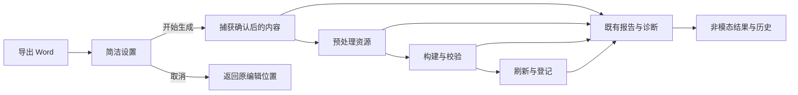

# Word 导出、交互与样式优化设计

> 2026-10-29 整合说明：D7 保留 CF-01—CF-06，D8 补本次授权的 VS-01—VS-03 样式设计。实施入口只有 `tasks.md`：7—12 → 14—15 → 13；保留既有编号与完成证据，13 仍作为最终集成。D1—D6 为前次背景，不重复实施，不另建样式 change。

## Context

动机和范围见 [proposal.md](proposal.md)。以下为基准 `49a594e` 的源码核对，均不代表运行复现：

| 位置 | 当前行为 | 本次需要闭合的差额 |
| --- | --- | --- |
| `doc_tool/ui/project_bar.py:112` | 主按钮叫“导出正式 Word”，旁边平铺设置及多种出稿动作 | 一个日常主操作，正式状态在结果中如实显示 |
| `doc_tool/ui/main_window.py:4832` | 正常环境默认先打开设置，测试环境默认绕过；直接路径调用保存全部与版本同步 | 保留先设置再提交，统一正常/测试路径；当前内容在快照内使用 |
| `doc_tool/ui/export_settings_dialog.py:203` | 基础区混合文档属性、域代码说明、格式、刷新、范围、来源及文件设置 | 常用设置预填可见，高级属性和排版折叠，保留一次明确确认 |
| `doc_tool/ui/main_window.py:5261` | 展示成果面板后仍打开多按钮结果对话框 | 普通完成只更新现有非模态结果 |
| `doc_tool/application/project_export.py:457`、`doc_tool/ui/export_rounds.py:131` | 构建结果压缩为最后阶段文字，展示模型不携带错误码、源位置和日志关联 | 诊断随原报告传递到历史和结果卡片 |
| `doc_tool/application/prepared_source.py:447`、`pipeline.py:1019` | Mermaid 创建每章临时资源目录，该章资源根被整体覆盖 | 生成图与原始图片分别保留真实身份 |
| `scripts/build_docx.py:3398`、`scripts/validate_docx.py:654` | 构建和校验优先使用该章临时根，校验直接打开普通图片 | 对同一引用使用同一可信资源；缺图返回源位置与处理事实 |
| `doc_tool/ui/main_window.py:5322` | 复制阶段诊断主要读取 Word 刷新记录 | 输入准备和资源失败也有完整诊断 |
| `doc_tool/application/project_export.py:193` | 聚合索引写到固定 `export-result.json` | 保持最新索引兼容，按导出与执行保留诊断引用 |

截图的嵌套 `doc-tool-prepare-*` 临时路径与上述资源根覆盖链路吻合，但原图是否存在、截图包版本及实际失败阶段尚未复现。任务 1 必须先用合成夹具确认触发条件，发现不同原因时依据新证据修正实现落点，不先增加盲目重试。

## Goals / Non-Goals

**Goals**

- 将现有导出用例自动接续，保留导出前设置确认，减少字段负担和重复弹窗；交互契约见 `pyside6-app-shell` 增量。
- 使用现有任务事件、报告、捕获和正式状态，贯通诊断并让原位置可定位；结果契约见 `work-detail-pane` 与 `export-diagnostics`。
- 修复已确认的混排资源解析差额，保持构建和校验一致；资源契约见 `docx-expression-contract` 增量。

**Non-Goals**

沿用 proposal 的范围外事项。本设计不新增业务状态机、审批、模型调用、依赖或强制用户维护的配置/治理文件，不更改已有路径边界和正式登记条件。

## Decisions

### D1. 统一设置入口与确认后的当前内容捕获

- 本轮用户明确要求先设置。`ProjectBar` 的导出区呈现“导出 Word…”“更多”和简短最近结果入口；主按钮上的省略号表达将先进入设置。快速构建、正式出稿和其它格式仍有原菜单路径，不另平铺一个导出设置按钮。
- 顶部主按钮、菜单与 Ctrl+E 均打开同一个 `ExportSettingsDialog`，复用其请求构造和现有 `ExportRequest`、`_submit_export_request()`、TaskRunner。其他格式也在同一设置页操作。
- 设置页优先展示文件名、保存位置、范围、内容来源及格式/模板摘要。文件名从当前项目资料预填，可复用上次有效目录等便利偏好；文档属性、字段刷新细节和排版选项折叠，普通作者不必理解 DOCPROPERTY、TOC、NUMPAGES。
- 初始默认仍为 Word、整份、当前内容、既有模板、非严格；用户确认的本次选择才是实际请求。上次部分范围、saved 来源和 strict 不暗中成为普通入口默认值，原记录恢复则明确带入该次范围并供确认。
- 打开设置只做轻量预填和字段校验，不先建快照、保存正文或启动 Word。用户点击“开始生成”时再次采集实际选择来源和最新缓冲，建立本次捕获；既有属性/修订版本在本次输入内解析，不通过 `save_all()` 或保存 manifest 来完成一次导出。
- 字段变化更新实际输出摘要，可提前确定的输入错误在原字段旁说明且保留填写；动态 I/O 或后台错误交给原服务和诊断。设置确认后不再追加配置摘要、保存全部或发布检查确认页。
- 取消或 Esc 退出设置不建任务、不产生失败轮次、不写正文，回到原编辑位置。移除测试环境业务分流，自动化也必须走打开设置、确认提交的真实默认路径。

取舍：保留一次必要设置确认，把便利性落实到自动预填、字段分层、即时提示和统一提交。已有表单与导出引擎继续复用，完成反馈采用原非模态结果。

### D2. 诊断从原执行事实贯穿全程



- 在捕获前建立一次导出执行上下文，使用既有身份生成能力；快照建立后绑定真实 captureId。捕获失败也返回可诊断结果，不等到 Word 刷新才开始收集证据。
- 扩展原 `ExportReport` / `FormatResult`，将 `PipelineResult.events`、错误码、位置和日志关联传出；`RoundFormatView` / `ResultState` 仅适配同一数据，不再从消息文本反推状态。
- 保留已有 `wordRefresh` / `wordStages`，将其作为 Word 阶段证据，不拿它们替代整个导出过程。现有阶段标签表与 TaskEvent 继续是进度事实来源。
- 下表为本变更新增的候选诊断字段，具体类型在任务 3.1 固化；既有字段继续兼容。

| 字段 | 用途 |
| --- | --- |
| `schemaVersion` | 诊断结构版本，与既有导出索引 schema 分开 |
| `executionId`、`roundId`、`captureId` | 关联一次执行、所属导出与已建立的输入捕获；未知值明确为空 |
| `stages`、`failedStage`、`errorCode` | 原阶段事件及其真实失败，不创建第二套阶段推导 |
| `locations` | 原项目相对 Markdown 路径、原行号、内容摘要及位置可核实性 |
| `resources` | 逻辑引用、捕获/模块/生成来源、实际解析位置和已知摘要 |
| `logRefs`、`reportRefs` | 对应本次执行的持久日志/报告引用 |
| `persistence`、`message` | 诊断是否已保存及可理解摘要，不承担业务完成状态 |

- 捕获、预处理、构建、校验、刷新、复制成果/登记和诊断写入各自保留错误事实。异常转译不能只剩 `str(exc)` 或最后一条事件。
- 对位置未知和阶段未执行显式呈现；不从临时文件名猜章节，不用当前项目的日志冒充旧执行记录。

取舍：仅给结果页加“打开日志”按钮仍可能打开原项目的另一份日志；诊断必须先在报告与快照之间建立真实关联。

### D3. 按资源来源解析，构建与校验复用

- 在预处理结果中保留每个生成图的来源与文件映射；普通图片引用仍指向本次捕获的项目资源，模块资源沿显式安装/展开记录取得。
- 复用或扩展现有共享资源解析能力，供 `build_docx.py` 与 `validate_docx.py` 使用。输入包含资源身份、捕获资源根、生成图映射和允许边界；返回已核实文件及其来源，或带原 SourceLocation 的结构化错误。
- 只有明确生成图才从本章生成目录取文件；普通 PNG 不因该章出现 Mermaid 而切换来源。不得靠跨目录搜索或先找到的同名文件兜底。
- 构建与校验使用同一资源字节及失败分类。原图真实缺失的普通/严格策略沿用已有契约，不通过跳过图片检查解决临时根错误；可读占位或失败结果保留其真实说明。
- 原始解析的块位置要随预处理替换保留映射，后续普通图片不能因 Mermaid 转图减少行数而定位到错误行。
- 原捕获重试继续使用捕获资源；即使原项目已有新图，也不能为了重试成功偷偷混入新内容。

取舍：把所有资源复制进每个 Mermaid 临时目录会增加多章重复复制，仍易出现同名歧义；以来源映射统一解析，必要的模块拷贝沿用原职责，不全量复制工程。

### D4. 自动保存机器事实与同源 Markdown

- 复用既有导出报告序列化，新增可选诊断字段；保持 `export-result.json` 的既有读取与退出码契约。
- 为每次导出及重试执行保留稳定档案，默认候选目录为项目 `logs/exports/<roundId>/<executionId>/`。只读项目使用本次明确允许且可写的导出位置内诊断目录，均不可写则保留内存可复制摘要并标明未保存。
- 同一次归档包含最小机器诊断、由它生成的 `diagnostics.md` 及所需日志/报告摘要；不复制正文、原件、凭据或整个工作快照。重试另存执行记录，不能覆盖前次失败证据。
- 使用现有安全临时写入/替换方式发布档案和引用；只有完整写入后才标已保存。最新索引保持兼容，历史可从保存的原报告/引用恢复，展示沿用现有数量限制。
- 临时资源清理不影响持久诊断；应用正常关闭和重开仍可读取。诊断数据不直接决定正式状态，也不因写入失败撤销已经可用的成果。
- Markdown、界面和 CLI 使用同一事实投影。对外复制默认输出项目相对位置与脱敏技术路径，以白名单字段避免正文、认证信息或异常局部变量泄露。

取舍：只在弹窗复制诊断不利于事后排查；要求作者额外维护文件会增加负担，因此由工具自动生成，作者按需查看。

### D5. 一个结果面板与一个主要动作

- `_on_export_task_done()` 适配原报告后只更新 TaskDock/ExportResultsView；取消普通完成的 `_present_export_report()` 模态框，保留确实需要用户决定的原有交互。
- 结果卡片顶部对齐，先给结论、可用文件、失败阶段和可核实原位置；短原因可见，技术路径/错误码/日志在常驻可展开详情。打开文件和定位 Markdown 是不同动作。
- 历史优先展示导出时间、成功/部分完成/失败及内容来源；roundId/captureId 在详情中保留，不要求作者理解其内部含义。
- 恢复建议继续采用现有事实派生和动作白名单，不引入模型或新流程状态。沿原输入补未完成阶段直接复用其已确认设置；按当前内容新生成先打开预填设置，确认后建立新捕获。动作选择规则如下。

| 实际事实 | 主要动作 | 次级动作与限制 |
| --- | --- | --- |
| Word 可用 | 打开 Word | 打开目录、诊断、其它格式与记录 |
| Word 待刷新 | 打开可读 Word | 有能力时继续刷新，真实待办保持 |
| 原 Markdown 问题且位置可信 | 定位问题 | 查看诊断；处理前不盲目重试 |
| 故障适合重试且原输入可核实 | 重试本次导出 | 明示沿用本次内容；当前内容生成是独立动作 |
| 原输入缺失 | 按当前内容导出… | 先确认预填设置，再建立新输入；原内容重试不可用 |
| 无可靠源位置或未知故障 | 查看诊断 | 说明限制，不显示虚假定位或目录修复 |

- 点击前再次校验项目、选中导出、捕获和适用事实，拒绝陈旧操作。迟到后台结果只登记到其所属项目/执行，不抢焦点或覆盖另一条记录。
- 默认不因未知失败启动自动循环重试；先修复可证实根因，再提供有明确来源的一次恢复动作。

### D6. 四种交互状态与操作预算

以下为交互线框，表示目标行为，不代表已经实现或经过实机验收。所有恢复动作仍按 D5 的事实选择，不因线框示意固定展示全部按钮。

**准备导出与设置确认**

```text
[导出 Word…  Ctrl+E]  [更多 ▾]  [最近导出]

导出 Word
文件名：<按当前项目信息预填>
保存到：<有效目录>                         [更改]
范围：整份文档 ▾
内容：当前编辑内容（含未保存修改） ▾
格式 / 版式：Word · 沿用原有格式
▸ 文档属性与高级选项
                              [取消] [开始生成]
```

默认打开这一页设置，常用值已预填。作者可以直接确认，也可以改位置、文件名、范围或来源；选择已保存版本时同页提示未保存修改不会纳入。文档属性、其它格式、刷新和复杂排版在高级区域展开，仍在同一页提交。长名称和路径省略显示，完整值可查看或复制；字段错误就地提示，不清空其它输入。

在 1024×640 下，折叠高级项的基础字段和开始/取消按钮应直接可见；高级内容可滚动，提交区保持可达。用户只需一次设置确认，取消即返回编辑，既有正文和成果不受影响。

**正在生成**

```text
[正在生成…]  [更多 ▾]  [最近导出]
当前阶段：<实际阶段>  已用：<实际时间>  [取消]
```

主按钮在冲突任务期间不可重复提交；更多内仍可查看结果/诊断，冲突命令说明原因。进度来自现有阶段事件，不虚构百分比。取消沿用安全边界，等待时明确显示等待停止。作者继续编辑，结果仍对应开始时捕获；捕获后发生修改时补充“开始后内容已更新”的说明。

**生成成功**

```text
Word 已生成                         <完成时间>
<文件名> · 整份 · 生成开始时的内容
[打开 Word]  [更多 ▾]
```

可读稿待刷新、部分格式失败按真实状态替换标题或补充短提醒；打开已确认稳定副本。工具不自动启动 Word、不抢键盘焦点，也不强制展开用户已收起的侧栏。可见结果面板就地更新，隐藏时通过最近结果入口和简短状态反馈。

**生成失败**

```text
导出未完成：<可理解的原因>
阶段：<实际失败阶段>
位置：<可核实的原章节与行号>
[定位问题]  [更多 ▾]
▸ 诊断详情
```

上例的定位按钮仅在位置可信时出现；其它失败类型按 D5 选择主动作。短摘要持续可找，不让临时路径和长异常占满整张卡片。展开诊断即可复制 Markdown 或打开本次日志，关闭后不丢失记录。问题定位复用既有导航历史，保留此前章节、光标和滚动状态，提供明确返回动作。

| 常见目的 | 操作预算与反馈 |
| --- | --- |
| 已打开有效项目，导出并打开 Word | 打开设置 → 开始生成 → 打开 Word，默认值有效时三次主要操作；仅一次设置确认，无重复配置或完成弹窗 |
| 进入导出设置 / 高级项 | 主入口一次打开设置，高级项在本页一次展开，不另开第二套设置或向导 |
| 在可见失败卡片定位原因 | 一次点击定位；未知位置显示限制，不给虚假入口 |
| 定位问题后返回原写作位置 | 一次返回动作，恢复原章节、光标和滚动位置 |
| 从可见失败卡片复制诊断 | 展开诊断 → 复制 Markdown，两次操作；不要求找文件或重跑 |
| 查旧导出 | 从最近导出进入，以时间和结论选择；技术标识在详情中 |

键盘行为：Ctrl+E 在可用时打开同一设置页；Tab 顺序遵循视觉布局，主要按钮与菜单有清晰焦点。Esc 取消未提交设置或关闭当前菜单/诊断并回到调用处，取消后台任务使用明确取消动作。设置打开期间焦点位于表单，提交或取消后返回原编辑位置；后台结果不抢焦点。1024×640 下导出、开始/取消及失败主动作完整可达，长错误可换行/展开；结果内容从顶部排布，避免截图中错误悬在大块空白中央。

### D7. 六项最小修正的执行设计

#### D7.1 当前差额与修改落点

核对基准为 `5c46b1baa56b5116d264d50e1572170b7a93fa74`，当前分支 `main`。Codegraph: not used（无项目索引），以下为源码事实，业务复现与运行验证均为 `not-run`。行号只作本轮定位，执行前按符号重查；源码已被他人修复时验证后跳过对应实现，不重复改写。

| 编号 | 当前源码事实 | 首选修改位置 | 就近测试 |
| --- | --- | --- | --- |
| CF-01 | `project_bar.py:273` 将隐藏的导出设置登记为普通溢出项；`ActionOverflow.refresh` 会再次按宽度显示它 | `ui/project_bar.py`；优先使用已有 `overflow_only` | `test_ui_polish_quick_export.py`、`test_action_positioning.py` |
| CF-02 | `editor_panel.py:1490-1512` 重新显示低频按钮并清空预置菜单，初始隐藏失效 | `ui/content/editor_panel.py` 的构建与 `_reflow_format_toolbar` | `test_ui_polish_toolbar.py` |
| CF-03 | `_on_regenerate_round` 和 `_on_change_export_destination` 直接启动新导出；设置 `exec()` 对 offscreen 自动确认 | `ui/main_window.py`、`ui/export_settings_dialog.py` | `test_core_export_ui.py`、`test_ui_polish_quick_export.py`、`test_export_round_recovery.py` |
| CF-04 | `_run_docx` 无输出分支只返文字和错误码，聚合只记录 prepare/格式名；失败 UI 平铺恢复按钮 | `application/project_export.py`、`ui/export_rounds.py`、`ui/export_results_view.py` | `test_main_e_export_rounds.py`、`test_ui_polish_results.py` |
| CF-05 | 编辑器只记录 mtime；`_collect_buffer_texts` 不核对外部变更；`capture_snapshot` 在 current-buffer 下直接取缓冲 | `ui/content/editor_panel.py`、`ui/main_window.py`、`ui/export_settings_dialog.py`、`application/effective_snapshot.py` | `test_core_export_snapshot.py`、`test_core_export_ui.py` |
| CF-06 | `_on_validate` 调旧持久化函数，实际版本不同可写 `project.yml`；F5 没有像 `_on_content_lint` 一样展开 Dock | `ui/main_window.py`、必要时 `ui/controllers/export_orchestrator.py` 的现有调用边界 | `test_core_export_ui.py`、`test_main_d_lint_scope.py` |

`_workspace` 是旧保存分支引用的字段，正常窗口使用 `_content_workspace`。不能据旧函数名声称 F5 一定保存了全部正文；本轮明确修正的是检查路径包含版本写回副作用，并以真实窗口确认正文和脏标记保持。

#### D7.2 固定动作位置，复用当前工具栏

- CF-01：将导出设置与已有诊断构建、正式出稿一样固定登记到更多。保持导出 Word、成果、检查、分支等其它现有入口的布局和权限；不扩展通用动作注册框架。
- CF-02：在当前编辑器构建逻辑中区分常用格式和固定菜单项。低频工具与回滚/历史/外部打开不再参加“有空间就显示”的候选计算；现有更多菜单重建时先恢复固定条目，再加入确实溢出的常用条目，并按同一动作去重。
- 沿原按钮或动作执行，保留 enabled/只读/撤销语义。使用现有元组或局部列表足够，不引入策略类、插件注册表、动态上下文工具栏或新的页面偏好文件。
- 宽度验证覆盖首次显示、1024×640、1280×720、较宽窗口、预览/侧栏开关、主题和任务状态变化。只读/禁用动作仍按旧规则禁用，不以隐藏按钮代替权限校验。

#### D7.3 设置与提交只有一条日常路径

```text
按钮 / 菜单 / Ctrl+E
  → _on_export_settings()
旧结果“按当前内容生成” / 更改位置
  → 构造原参数预填（明确新来源和实际范围）
  → _on_export_settings(preset_request)
用户确认
  → 本次来源校验 → _submit_export_request → _run_export_task → run_project_export
原内容重试
  → 核对旧报告与输入 → retry_export_formats（不收集当前正文）
```

复用 `_round_request`、`_new_round_request` 和现有设置；失效范围继续在设置内明示。更改位置从同一表单修改，取消时不启动新导出。移除设置 `exec()` 因 `QT_QPA_PLATFORM=offscreen` 自动提交的分流；测试应通过 Qt 事件在同一对话框点取消/开始，不以业务代码识别测试环境。检查私有 `prompt_settings=False` 调用者，日常入口不得借它绕过确认；非交互导出仍直接使用已有应用服务和 CLI。

Ctrl+E 用真实按键验证一次开窗/一次提交。若存在按钮与 QAction 双重注册引发的歧义，只消除重复注册并保留一个现有窗口级绑定；测试未发现的其它快捷键不顺手重构。

#### D7.4 F5 保持检查职责

CF-06 从 F5/顶部检查路径移除 `_flush_unsaved_and_sync_version` 调用，保留基于活缓冲的 `ContentWorkspace.run_lint`、原检查范围和执行事实。对应菜单复用该检查入口，主动检查展开已有工具 Dock 并定位格式检查页；索引未就绪如实显示未执行。

既有替换、重命名后的自动校验调用 `_on_content_request_validate`。主动入口展开结果，自动联动保持原面板偏好；需要时使用现有回调上下文或一个轻量参数区分，不增加检查状态机。旧持久化辅助仍可能被正式出稿等路径使用，只修当前调用边界，不全局删除。允许已有报告/缓存更新，测试比较的是 Markdown、修订记录、`project.yml` 和脏标记，不误将正常报告写入判为正文写入。

#### D7.5 诊断接线与一个主要动作

CF-04 沿原链补字段：`PipelineResult.events` → `FormatResult.failed_stage/locations/diagnostics` → `ExportReport.diagnostics` → `ExportRoundView` → `ExportResultsView`。优先从实际 failed 事件取得阶段、错误码和 `metrics.locations`；不能只取 `last_stage`，因为后面可能还有 skipped/清理事件。可用文件与失败阶段分开保留，不能因 `usable=True` 丢弃真实失败，也不能为了字段齐全填造未执行阶段。

沿 `exception_locations` 的 `relPath`、原内容根和已有预处理映射回到原项目章节；保持现有位置口径，不从临时目录文件名猜源文件。拿不到可信位置或当前内容已陈旧时显示限制，主要动作改为诊断，不误跳。复用 `FormatResult.diagnostics` 和既有诊断可选字段，不升级报告 schema、不新增业务生命周期；普通缺图/严格策略、可读稿和正式登记判定保持。

| 当前已核实事实 | 主要动作 |
| --- | --- |
| 有可打开 Word（含待刷新或附加格式失败） | 打开 Word，保留真实待办说明 |
| 无 Word，有可核实源问题 | 定位问题 |
| 无 Word，明确为输出位置问题 | 打开预填设置，更改位置后确认 |
| 无 Word，已知适用重试且原输入可恢复 | 重试本次内容 |
| 原输入失效，需要用最新内容再导出 | 按当前内容生成，进入设置 |
| 未知原因、位置不可信或缺少恢复依据 | 复制该次诊断 |

保留一个主要按钮和已有更多入口，主要动作不在次级区重复。`has_retryable` 的失败/待办状态只能作为候选，不能单凭它承诺重试能解决问题。其它仍适用动作在更多保留；项目、选择结果及身份变化后按原保护拒绝陈旧动作，不新建恢复引擎。

将该次必要阶段事实和日志/报告引用接入已有 `diagnostics.json`、`diagnostics.md`。结果中的“打开本次记录”使用所选报告已保存位置，只有真实存在才可打开；缺少日志则说明未知或未保存，仍可复制已有内存诊断。全局“项目日志目录”保持原工具语义，不让它冒充结果专属日志。复制和保存沿现有脱敏投影，不收集全文或异常局部变量。旧索引兼容、写诊断失败保留成果；本轮不建设新的历史目录索引或整套日志系统。

#### D7.6 外部修改只做必要来源保护

CF-05 不做自动合并或常驻文件监控。只在打开/确认新导出以及实际读取输入时，核对本次选中且存在脏缓冲的章节。干净窗口不作为正文覆盖，磁盘新内容自然进入原捕获；范围外冲突不阻断本次导出，原捕获重试不进入此检查。

1. 优先复用现有基准；当前只有 `_mtime`，若不足以区分内容变化，在 `EditorPanel` 加一个仅在内存中的已加载磁盘内容摘要。`load`、成功保存、外部重载和重挂路径保持基准语义；`load_draft` 以可读磁盘为基准或标未知，不能用草稿文本冒充磁盘原文。mtime 可作快速线索，实际冲突以内容比较为准；测试含修改时间相同但内容不同的写入。
2. 复用设置中的内容来源下拉与提示/错误区域，展示涉及章节和影响。发现分叉时不能静默保持默认项；用未选择状态要求明确采用窗口或磁盘，选项文案分别说明另一方修改未纳入。选择磁盘是本次既有 saved 来源语义，其余未保存章节也不纳入，摘要须说明。无需新增确认弹窗、逐章问答或合并编辑器。
3. 提交时重新读取实际缓冲和磁盘事实。表单打开期间变化导致新冲突时保留表单参数并要求核对；无冲突仍是打开设置→开始→打开成果三次主要操作。取消不创建任务/捕获，不保存正文。
4. 防止确认到捕获间的变化：优先复用现有捕获的摘要和读取点；必要时仅给现有 `run_project_export`/`capture_snapshot` 调用增加可缺省的内存预期摘要参数（名称为实施候选），GUI 传入本次已核实值，CLI 未传保持兼容。在**用于捕获的同一份读取字节**上核对，而非校验后再无保护地重读。变化时沿已有输入准备失败返回原章节和原因，捕获未完成则不伪造 captureId；保持所有原输入和旧成果。此参数不进入 project.yml、导出设置或新的持久状态。

若采用更小的等价实现，须通过同样的来源/竞态验收；不能靠自动保存、静默重载脏编辑器或放宽断言绕开冲突。

#### D7.7 验证与交付边界

每组实现同时补就近用例和实际指南说明，最终只做受影响集成。用已有 `scripts/tests/run_tests.py` 和夹具，不创建新的测试平台。正常按钮、菜单和真实 Ctrl+E 经同一设置确认；mock 只用于观测提交或注入外部失败，不替代核心处理器、自动接受设置或手工塞位置证明整链通过。

结果诊断至少一条测试经过真实导出/内核负向夹具到最终展示；普通模式缺图若本来降级为占位，应保留该策略，选会真实产生结构化错误的已有负例。F5 比较源文件/配置摘要，冲突组检查缓冲、磁盘、产物和原捕获身份，布局组在实际重排后断言可见/菜单项和点击次数，不只检查构造后的 `isHidden()`。

报告写入独立 `analysis/core-interaction-followup-<唯一后缀>/`，避免覆盖旧 UI 截图和 XML。已发现 `test_export_round_recovery.py:276` 将场景产物写入固定历史目录，任务 9.1 在运行该脚本前先让它读取已有 `DOC_TOOL_TEST_ARTIFACT_ROOT` 覆盖值，未提供时保留原默认；这只是测试输出隔离，不改变业务路径。runner 一个 JUnit testcase 代表一个测试脚本，交付分别报告脚本数、内部用例、失败、跳过和退出码。真实 Word、冻结包、原生 125%/150% 缩放沿旧 6.3 单独列状态，不以离屏测试代替。只因环境缺少不能代勾历史待办。

本轮不修改首页、章节树布局、视图/字号、模板/图表策略、更新器、CLI 功能或版本号，不新增依赖和后台服务。需回退时只撤回本轮确认的文件差异，保留源文档、历史成果和其它人的改动。无用户明确要求不提交、推送、发布、切分支或归档。

### D8. 与六项修正一并执行的样式设计

#### D8.1 样式边界与源码依据

VS-01—VS-03 的行为权威分别在 `pyside6-app-shell` 与 `work-detail-pane` 增量。用户明确要求在上一份计划内优化样式；本节取代早期 UI 文档“不调整任何间距”的限制，仅限以下主流程区域。正文编辑字号、Markdown/Word 格式、首页/章节树/摘要/导航结构、导出参数及诊断事实不变。

源码核对（当前工作区，非运行验收）：

| 真实落点 | 已有基础 | 本轮只需补的内容 |
| --- | --- | --- |
| `doc_tool/ui/styles.py` | `build_qss`、深浅色板、4/8/12/20 间距、10/9/12/16pt 字体、`btnRole`/`statusTone`/`cardClass` | 复用现有值，为本轮区域补缺失的控件层级、焦点和错误规则，避免增加第二套样式表 |
| `project_bar.py`、`content/editor_panel.py` | `projectBar`、`editorToolbar` 与现有更多、宽度重排 | 只统一可见按钮的轻重和必要间距；CF-01/02 已修好的收纳规则保留 |
| `export_settings_dialog.py` | 滚动内容、固定提交区、来源说明与错误标签 | 对齐与分组；移除错误标签硬编码的 `#d32f2f`，接入主题语义；不改字段和校验语义 |
| `export_results_view.py` | `resultsRoundBox`、`resultsPrimaryBtn`、结果行、唯一主动作与更多 | 摘要和动作保持靠上，说明/路径可读；保留正在实施的动作分支 |
| `work_detail_pane.py`、`task_dock.py` | `resultTitle`、`resultLocations`、语义卡片和折叠日志 | 复用同一阅读层级；仅在本轮实际共用的卡片有差额时调整，不全局重写任务 Dock |

没有 `.codegraph` 项目索引，采用上述限定文件检索；无需补索引或引入设计工具。执行前须重读当前 diff，已满足的规则以验证交付，不为样式重构已有逻辑。

#### D8.2 统一视觉参数（实施默认值）

本表是样式参数的唯一设计来源，UI 文档只引用效果，避免维护两套参数。所有尺寸均为 Qt 逻辑尺寸，字体沿用现有 pt 定义；以内容的 `sizeHint`/字体度量为下限，不把参考高度做成最大高度或强制固定高度。

| 项目 | 采用值与规则 | 目的 |
| --- | --- | --- |
| 主色/底色 | 沿用 `_LIGHT`/`_DARK` 的 `accent`、`window`、`panel`、`border`、`text`；浅色主色现为 `#2563eb` | 不换品牌色，背景安静，只有主动作突出 |
| 标题/正文/辅助字 | 区域标题与结果标题 12pt/600，字段与短原因 10pt，辅助路径/说明 9pt；沿用中文字体栈 | 原因不再与技术路径挤在同一种小字里；不改正文编辑器字号 |
| 间距 | 同组紧密项 4，按钮/字段行 8，表单/结果内边距与区域间隔 12，大分组必要时 20；均复用现有常量 | 保持紧凑，无新增大块留白；底部剩余空间可自然留空 |
| 控件与按钮 | 主流程普通控件参考最小高度 30，紧凑工具按钮 26；字体度量与已有导航/工具栏尺寸优先，长中文按完整文本分配宽度 | 短按钮不挤，窄窗口不因统一高度撑坏现有栏位 |
| 圆角/边框 | 输入和紧凑控件沿用 4，按钮/结果卡片沿用 6，细边框 1；主页面不新增外层卡片 | 统一而不增加容器层级；无需阴影、渐变或动画 |
| 主要/次级动作 | 每个区域至多一个填充强调按钮；顶部导出、设置开始、结果的事实主动作使用已有 primary，其余中性 secondary/compact，更多较轻 | 视觉层级与已确认的操作层级一致；编辑器保存沿既有层级 |
| 焦点/悬停/禁用 | 沿主题 accent 呈现可见焦点边框，悬停只调整已有底色/边框，禁用态维持可读说明；边框变化不造成控件跳动 | 键盘可用，不能用悬停样式代替键盘焦点，也不改动作可用性 |
| 成功/警告/错误 | `statusTone` 文字＋现有语义色，卡片保持中性底色，错误原因用正文级字号，不整块铺红 | 深浅主题一致，待刷新、部分成功仍看得清 |

作用域优先使用既有对象名和属性。若设置/成果根控件缺少定位标记，可仅为这两个根控件新增 `coreFlowSurface` 属性（拟新增样式标记，不是现有接口），子选择器限定在此范围。禁止在控件中拼接新的配色常量、为此新增样式管理类，或修改通用 `QWidget`/全局字体使无关首页和 PDF 工具跟着变化。动态错误属性应正确刷新样式；仅更新变化控件，不重建窗口。

#### D8.3 主页面、设置与错误反馈

1. 顶部仍是“导出 Word… / 成果 / 检查 / 更多”，原项目身份、摘要和其它控件按 CF-01 保留。蓝色只强调导出；成果计数和检查使用中性层级，不增加状态卡、横幅或装饰图标。按钮间距按 D8.2，长标题沿原省略与完整提示，不抢主按钮宽度。
2. 编辑工具仍是原单行和原更多。常用控件高度、边距协调，保存与更多可达，低频工具不因窗口变宽返回；不通过减少字体、挤掉原格式或新增一层菜单实现整齐。
3. 设置内容保留单页顺序：文件名/位置 → 范围/来源 → 格式/模板摘要 → 高级区。使用现有布局调整标签对齐与行距；来源说明紧跟来源，输出摘要留在原位置。不要把每组包成新卡片，也不把默认值变成必填手工项。
4. 开始/取消固定在滚动区外，开始 primary、取消 secondary。长路径通过原输入框滚动/选择查看完整值；超长来源说明换行，不反向撑大整个窗口。
5. 在已有错误区域显示原因并保留输入；能确定字段时给对应控件错误边框并关联说明，修正后清除。无法定位字段则只显示整体原因，不猜测标红。来源分叉沿 CF-05 使用原来源选择区，不新增警告弹窗。将原硬编码红色替换成主题 failure；局部无法执行的校验不凭样式推断通过。

#### D8.4 结果排版与错误阅读顺序

1. 继续使用原成果面板和真实数据模型。上方保留轮次选择，接状态/短原因，接实际阶段和原位置，再接唯一主要动作与更多；格式结果按原顺序排列，技术详情沿原折叠入口。为避免长内容把主动作挤出首屏，将可增长的日志/格式明细置于原滚动区，摘要及动作保持可达，不复制第二套摘要或按钮。
2. 顶层内容采用自然高度并顶部对齐，伸展空白留在内容之后；不在标题和原因之间加伸展项。短结果可以留出底部余白，禁止为了“填满面板”放大错误框或垂直居中。
3. 标题 12pt，短原因 10pt可换行，阶段/源章节及输出路径使用可读辅助文字。长路径优先换行；无法自然换行时允许在现有标签省略并提供完整提示和原复制入口。省略仅影响显示，完整诊断/剪贴板保持真实原文。
4. 主动作由 D7.5 决定；样式层不读错误字符串重新判断可重试性，不硬编码成功/失败/正式。窄侧栏沿原响应布局堆叠主动作和更多，不缩小字、不把按钮放到窗口外。
5. 展开诊断继续使用现有 Markdown/日志能力。去除常驻完整堆栈式摘要后，技术事实仍可展开、复制及按实际保存情况找回，不删字段或改变已有路径脱敏。

#### D8.5 联合验收与回退

先完成 CF 功能直接回归，再按任务 14 的各区域实现和验证；15.1 验证样式矩阵，最后执行原任务 13 的联合回归。保留旧编号，禁止因“样式整合”撤销别人勾选或复刻功能。必要时回退仅限本次局部 QSS/布局/属性，不回退来源保护、诊断、快捷键或动作选择。

| 场景 | 需要的证据 |
| --- | --- |
| 1024×640 / 1280×720 / 较宽主窗口，侧栏窄/宽 | 顶部、编辑工具、设置基本/高级、结果短/长内容的截图与关键控件几何；导出/保存/开始/取消/结果主动作及更多可达，无横向撑出 |
| 深浅主题，Tab 焦点与禁用态 | 相同数据和尺寸的对照截图；错误使用当前主题，焦点可见，中文正常显示；不能用缺字字体截图验收可读性 |
| 成功、待刷新、部分成功、可信源错、目录错、未知故障 | 短原因/位置/实际动作可读，诊断完整可取；样式夹具可验证布局，真实业务故障链路仍由 11.1/13.1 的集成证据负责 |
| 正常三次主要操作、来源冲突、F5 | 14 的样式不得改变 CF 行为或增加步骤；13 统一核对输入保护、焦点和面板偏好 |
| 原生 125%/150%、真实 Word/冻结包 | 继续关联原 6.3；没有环境保留未勾选，不以 `QT_SCALE_FACTOR` 离屏探针替代原生验收 |

复用 `test_action_positioning.py`、`test_ui_polish_toolbar.py`、`test_ui2_export_settings.py`、`test_ui_polish_results.py`、`test_ui_polish_geometry.py` 和现有高 DPI 探针。只为实际缺口增加几何/主题/可见性断言，不测试 QSS 字符串等于本次实现，也不为颜色替换建立一套测试框架。新增截图写入本次独立目录，不覆盖历史证据。所有实际运行的现有脚本输出单列；结构校验、离屏验证、原生桌面和 Word 验证分别报告。

## Risks / Trade-offs

| 限制 | 影响 | 处理与验证 |
| --- | --- | --- |
| 截图包版本和原 PNG 尚未核实 | 静态线索可能不是实际故障的全部原因 | 先用混排夹具复现；真实样例只在获准副本中复验，分别记录结论 |
| 旧索引没有诊断 | 无法补造历史源位置或阶段 | 可用成果继续显示，诊断明确未记录，读取不补写 |
| 快照日志位置与原项目不同 | 目录按钮可能打开错误日志 | 将本次引用随报告持久化；覆盖关闭/重开/清理临时目录 |
| 前处理改变行号或当前正文已变 | 定位可能落到别处 | 记录原位置和内容摘要；失配后说明陈旧，不直接写回 |
| 同名图或原图在捕获后更新 | 重试混用图片会产生错误文档 | 来源与摘要绑定；检验 DOCX 实际图片字节及原输入不变 |
| 设置与结果调整影响旧测试和快捷键 | 测试绕过设置而未验证真实提交 | 真实 Qt 点击设置并确认，检查提交次数、请求内容和脏标记；不保留测试专用业务分流 |
| 诊断落盘失败 | 失败后丢失可排查记录 | 安全写入、允许位置回退、内存复制及明确未保存状态 |

## Migration Plan

1. 固定现有分支和差额，补最小混排及真实默认点击的失败证据；不读取未获准业务工程。
2. 统一资源解析与位置映射，再贯通诊断数据、持久化和兼容读取。
3. 收敛项目条和简洁设置，统一确认后的提交及非模态结果，接入基于事实的主要动作与历史。
4. 运行定向回归和实际 UI 路径；具备环境时执行真实 Word、冻结包及用户样例复验，未执行项保留 `not-run`。
5. 更新现有用户指南和本 change 的任务/验证记录。只在实际实现与验收后勾选任务，本次规划不完成实现或归档。

兼容与回退：旧项目清单、CLI 参数、聚合索引已有字段及旧成果保持可读；新增字段默认可缺省。回退实现时旧读者忽略新增诊断引用，原文件和诊断档案保留，不对项目做破坏性迁移。历史 change 的实机待办保持原状态，不由本计划代为勾选。

## Verification Plan

| 场景组 | 必须观察到的结果 |
| --- | --- |
| 普通图片 / Mermaid / 两者同章 / 多章同名不同图 | 原图和生成图实际进入 DOCX，构建与校验读取正确字节，源摘要不变 |
| 图渲染失败、真实缺图、坏路径 | 沿用已声明策略，原因和原位置可查，校验不被绕过 |
| 未保存正文、修订记录、旧单章设置 | 设置默认整份当前内容，采用本次确认的选择，原磁盘/版本/脏标记保持 |
| 按钮 / 菜单 / Ctrl+E 的正常执行路径 | 都先打开同一简洁设置，仅确认后一次提交；取消不启动，无保存全部或普通完成模态框 |
| 四态交互、焦点、键盘和返回路径 | 满足 D6 操作预算，收起侧栏不被强开，定位后一步恢复原编辑位置，Esc 不误取消任务 |
| 输入准备、预处理、构建、校验、刷新、写文件失败 | 分别保留实际阶段、错误码和日志关联，来源未知不猜造 |
| Word 不可用、PDF 失败、登记未完成、取消 | 可用文件保留，正式状态和剩余事项如实显示 |
| 旧输入重试 / 当前内容生成 / 切项目 / 迟到结果 | 输入身份正确，旧记录不被覆盖，陈旧动作被拒绝 |
| 清理临时目录、关闭/重开、旧索引、诊断目录不可写 | 历史或限制可理解，可复制摘要与实际保存状态一致 |

自动化优先使用现有 `scripts/tests/run_tests.py`，新用例应注册到现有 runner 的实际清单；报告写入本次独立证据目录，记录文件数、用例数、失败、跳过及退出码。用例通过不替代真实 Word 分页、原生桌面缩放和冻结包验证。规划结构检查只运行 OpenSpec strict，业务验证在实施阶段执行。

## Open Questions

- 截图运行包的版本和源 PNG 状态：由任务 1 的合成复现与获准样例复验核实；当前不宣称截图故障已恢复。
- 真实企业底模、Microsoft Word、原生 125%/150% 缩放和冻结运行环境是否可用：由实施时探测决定验证状态，缺少环境不放宽验收标准或把模拟记录当实机记录。
