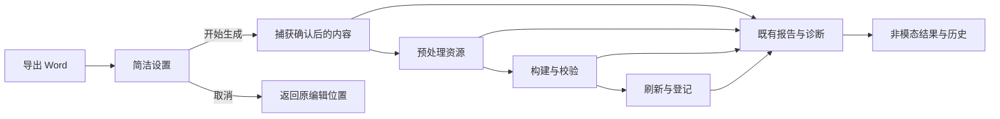

# Word 导出简化与可定位诊断设计

## Context

动机和范围见 [proposal.md](proposal.md)。以下为基准 `49a594e` 的源码核对，均不代表运行复现：

| 位置 | 当前行为 | 本次需要闭合的差额 |
| --- | --- | --- |
| `doc_tool/ui/project_bar.py:112` | 主按钮叫“导出正式 Word”，旁边平铺设置及多种出稿动作 | 一个日常主操作，正式状态在结果中如实显示 |
| `doc_tool/ui/main_window.py:4832` | 正常环境默认先打开设置，测试环境默认绕过；直接路径调用保存全部与版本同步 | 保留先设置再提交，统一正常/测试路径；当前内容在快照内使用 |
| `doc_tool/ui/export_settings_dialog.py:203` | 基础区混合文档属性、域代码说明、格式、刷新、范围、来源及文件设置 | 常用设置预填可见，高级属性和排版折叠，保留一次明确确认 |
| `doc_tool/ui/main_window.py:5261` | 展示成果面板后仍打开多按钮结果对话框 | 普通完成只更新现有非模态结果 |
| `doc_tool/application/project_export.py:457`、`doc_tool/ui/export_rounds.py:131` | 构建结果压缩为最后阶段文字，展示模型不携带错误码、源位置和日志关联 | 诊断随原报告传递到历史和结果卡片 |
| `doc_tool/application/prepared_source.py:447`、`pipeline.py:1019` | Mermaid 创建每章临时资源目录，该章资源根被整体覆盖 | 生成图与原始图片分别保留真实身份 |
| `scripts/build_docx.py:3398`、`scripts/validate_docx.py:654` | 构建和校验优先使用该章临时根，校验直接打开普通图片 | 对同一引用使用同一可信资源；缺图返回源位置与处理事实 |
| `doc_tool/ui/main_window.py:5322` | 复制阶段诊断主要读取 Word 刷新记录 | 输入准备和资源失败也有完整诊断 |
| `doc_tool/application/project_export.py:193` | 聚合索引写到固定 `export-result.json` | 保持最新索引兼容，按导出与执行保留诊断引用 |

截图的嵌套 `doc-tool-prepare-*` 临时路径与上述资源根覆盖链路吻合，但原图是否存在、截图包版本及实际失败阶段尚未复现。任务 1 必须先用合成夹具确认触发条件，发现不同原因时依据新证据修正实现落点，不先增加盲目重试。

## Goals / Non-Goals

**Goals**

- 将现有导出用例自动接续，保留导出前设置确认，减少字段负担和重复弹窗；交互契约见 `pyside6-app-shell` 增量。
- 使用现有任务事件、报告、捕获和正式状态，贯通诊断并让原位置可定位；结果契约见 `work-detail-pane` 与 `export-diagnostics`。
- 修复已确认的混排资源解析差额，保持构建和校验一致；资源契约见 `docx-expression-contract` 增量。

**Non-Goals**

沿用 proposal 的范围外事项。本设计不新增业务状态机、审批、模型调用、依赖或强制用户维护的配置/治理文件，不更改已有路径边界和正式登记条件。

## Decisions

### D1. 统一设置入口与确认后的当前内容捕获

- 本轮用户明确要求先设置。`ProjectBar` 的导出区呈现“导出 Word…”“更多”和简短最近结果入口；主按钮上的省略号表达将先进入设置。快速构建、正式出稿和其它格式仍有原菜单路径，不另平铺一个导出设置按钮。
- 顶部主按钮、菜单与 Ctrl+E 均打开同一个 `ExportSettingsDialog`，复用其请求构造和现有 `ExportRequest`、`_submit_export_request()`、TaskRunner。其他格式也在同一设置页操作。
- 设置页优先展示文件名、保存位置、范围、内容来源及格式/模板摘要。文件名从当前项目资料预填，可复用上次有效目录等便利偏好；文档属性、字段刷新细节和排版选项折叠，普通作者不必理解 DOCPROPERTY、TOC、NUMPAGES。
- 初始默认仍为 Word、整份、当前内容、既有模板、非严格；用户确认的本次选择才是实际请求。上次部分范围、saved 来源和 strict 不暗中成为普通入口默认值，原记录恢复则明确带入该次范围并供确认。
- 打开设置只做轻量预填和字段校验，不先建快照、保存正文或启动 Word。用户点击“开始生成”时再次采集实际选择来源和最新缓冲，建立本次捕获；既有属性/修订版本在本次输入内解析，不通过 `save_all()` 或保存 manifest 来完成一次导出。
- 字段变化更新实际输出摘要，可提前确定的输入错误在原字段旁说明且保留填写；动态 I/O 或后台错误交给原服务和诊断。设置确认后不再追加配置摘要、保存全部或发布检查确认页。
- 取消或 Esc 退出设置不建任务、不产生失败轮次、不写正文，回到原编辑位置。移除测试环境业务分流，自动化也必须走打开设置、确认提交的真实默认路径。

取舍：保留一次必要设置确认，把便利性落实到自动预填、字段分层、即时提示和统一提交。已有表单与导出引擎继续复用，完成反馈采用原非模态结果。

### D2. 诊断从原执行事实贯穿全程



- 在捕获前建立一次导出执行上下文，使用既有身份生成能力；快照建立后绑定真实 captureId。捕获失败也返回可诊断结果，不等到 Word 刷新才开始收集证据。
- 扩展原 `ExportReport` / `FormatResult`，将 `PipelineResult.events`、错误码、位置和日志关联传出；`RoundFormatView` / `ResultState` 仅适配同一数据，不再从消息文本反推状态。
- 保留已有 `wordRefresh` / `wordStages`，将其作为 Word 阶段证据，不拿它们替代整个导出过程。现有阶段标签表与 TaskEvent 继续是进度事实来源。
- 下表为本变更新增的候选诊断字段，具体类型在任务 3.1 固化；既有字段继续兼容。

| 字段 | 用途 |
| --- | --- |
| `schemaVersion` | 诊断结构版本，与既有导出索引 schema 分开 |
| `executionId`、`roundId`、`captureId` | 关联一次执行、所属导出与已建立的输入捕获；未知值明确为空 |
| `stages`、`failedStage`、`errorCode` | 原阶段事件及其真实失败，不创建第二套阶段推导 |
| `locations` | 原项目相对 Markdown 路径、原行号、内容摘要及位置可核实性 |
| `resources` | 逻辑引用、捕获/模块/生成来源、实际解析位置和已知摘要 |
| `logRefs`、`reportRefs` | 对应本次执行的持久日志/报告引用 |
| `persistence`、`message` | 诊断是否已保存及可理解摘要，不承担业务完成状态 |

- 捕获、预处理、构建、校验、刷新、复制成果/登记和诊断写入各自保留错误事实。异常转译不能只剩 `str(exc)` 或最后一条事件。
- 对位置未知和阶段未执行显式呈现；不从临时文件名猜章节，不用当前项目的日志冒充旧执行记录。

取舍：仅给结果页加“打开日志”按钮仍可能打开原项目的另一份日志；诊断必须先在报告与快照之间建立真实关联。

### D3. 按资源来源解析，构建与校验复用

- 在预处理结果中保留每个生成图的来源与文件映射；普通图片引用仍指向本次捕获的项目资源，模块资源沿显式安装/展开记录取得。
- 复用或扩展现有共享资源解析能力，供 `build_docx.py` 与 `validate_docx.py` 使用。输入包含资源身份、捕获资源根、生成图映射和允许边界；返回已核实文件及其来源，或带原 SourceLocation 的结构化错误。
- 只有明确生成图才从本章生成目录取文件；普通 PNG 不因该章出现 Mermaid 而切换来源。不得靠跨目录搜索或先找到的同名文件兜底。
- 构建与校验使用同一资源字节及失败分类。原图真实缺失的普通/严格策略沿用已有契约，不通过跳过图片检查解决临时根错误；可读占位或失败结果保留其真实说明。
- 原始解析的块位置要随预处理替换保留映射，后续普通图片不能因 Mermaid 转图减少行数而定位到错误行。
- 原捕获重试继续使用捕获资源；即使原项目已有新图，也不能为了重试成功偷偷混入新内容。

取舍：把所有资源复制进每个 Mermaid 临时目录会增加多章重复复制，仍易出现同名歧义；以来源映射统一解析，必要的模块拷贝沿用原职责，不全量复制工程。

### D4. 自动保存机器事实与同源 Markdown

- 复用既有导出报告序列化，新增可选诊断字段；保持 `export-result.json` 的既有读取与退出码契约。
- 为每次导出及重试执行保留稳定档案，默认候选目录为项目 `logs/exports/<roundId>/<executionId>/`。只读项目使用本次明确允许且可写的导出位置内诊断目录，均不可写则保留内存可复制摘要并标明未保存。
- 同一次归档包含最小机器诊断、由它生成的 `diagnostics.md` 及所需日志/报告摘要；不复制正文、原件、凭据或整个工作快照。重试另存执行记录，不能覆盖前次失败证据。
- 使用现有安全临时写入/替换方式发布档案和引用；只有完整写入后才标已保存。最新索引保持兼容，历史可从保存的原报告/引用恢复，展示沿用现有数量限制。
- 临时资源清理不影响持久诊断；应用正常关闭和重开仍可读取。诊断数据不直接决定正式状态，也不因写入失败撤销已经可用的成果。
- Markdown、界面和 CLI 使用同一事实投影。对外复制默认输出项目相对位置与脱敏技术路径，以白名单字段避免正文、认证信息或异常局部变量泄露。

取舍：只在弹窗复制诊断不利于事后排查；要求作者额外维护文件会增加负担，因此由工具自动生成，作者按需查看。

### D5. 一个结果面板与一个主要动作

- `_on_export_task_done()` 适配原报告后只更新 TaskDock/ExportResultsView；取消普通完成的 `_present_export_report()` 模态框，保留确实需要用户决定的原有交互。
- 结果卡片顶部对齐，先给结论、可用文件、失败阶段和可核实原位置；短原因可见，技术路径/错误码/日志在常驻可展开详情。打开文件和定位 Markdown 是不同动作。
- 历史优先展示导出时间、成功/部分完成/失败及内容来源；roundId/captureId 在详情中保留，不要求作者理解其内部含义。
- 恢复建议继续采用现有事实派生和动作白名单，不引入模型或新流程状态。沿原输入补未完成阶段直接复用其已确认设置；按当前内容新生成先打开预填设置，确认后建立新捕获。动作选择规则如下。

| 实际事实 | 主要动作 | 次级动作与限制 |
| --- | --- | --- |
| Word 可用 | 打开 Word | 打开目录、诊断、其它格式与记录 |
| Word 待刷新 | 打开可读 Word | 有能力时继续刷新，真实待办保持 |
| 原 Markdown 问题且位置可信 | 定位问题 | 查看诊断；处理前不盲目重试 |
| 故障适合重试且原输入可核实 | 重试本次导出 | 明示沿用本次内容；当前内容生成是独立动作 |
| 原输入缺失 | 按当前内容导出… | 先确认预填设置，再建立新输入；原内容重试不可用 |
| 无可靠源位置或未知故障 | 查看诊断 | 说明限制，不显示虚假定位或目录修复 |

- 点击前再次校验项目、选中导出、捕获和适用事实，拒绝陈旧操作。迟到后台结果只登记到其所属项目/执行，不抢焦点或覆盖另一条记录。
- 默认不因未知失败启动自动循环重试；先修复可证实根因，再提供有明确来源的一次恢复动作。

### D6. 四种交互状态与操作预算

以下为交互线框，表示目标行为，不代表已经实现或经过实机验收。所有恢复动作仍按 D5 的事实选择，不因线框示意固定展示全部按钮。

**准备导出与设置确认**

```text
[导出 Word…  Ctrl+E]  [更多 ▾]  [最近导出]

导出 Word
文件名：<按当前项目信息预填>
保存到：<有效目录>                         [更改]
范围：整份文档 ▾
内容：当前编辑内容（含未保存修改） ▾
格式 / 版式：Word · 沿用原有格式
▸ 文档属性与高级选项
                              [取消] [开始生成]
```

默认打开这一页设置，常用值已预填。作者可以直接确认，也可以改位置、文件名、范围或来源；选择已保存版本时同页提示未保存修改不会纳入。文档属性、其它格式、刷新和复杂排版在高级区域展开，仍在同一页提交。长名称和路径省略显示，完整值可查看或复制；字段错误就地提示，不清空其它输入。

在 1024×640 下，折叠高级项的基础字段和开始/取消按钮应直接可见；高级内容可滚动，提交区保持可达。用户只需一次设置确认，取消即返回编辑，既有正文和成果不受影响。

**正在生成**

```text
[正在生成…]  [更多 ▾]  [最近导出]
当前阶段：<实际阶段>  已用：<实际时间>  [取消]
```

主按钮在冲突任务期间不可重复提交；更多内仍可查看结果/诊断，冲突命令说明原因。进度来自现有阶段事件，不虚构百分比。取消沿用安全边界，等待时明确显示等待停止。作者继续编辑，结果仍对应开始时捕获；捕获后发生修改时补充“开始后内容已更新”的说明。

**生成成功**

```text
Word 已生成                         <完成时间>
<文件名> · 整份 · 生成开始时的内容
[打开 Word]  [更多 ▾]
```

可读稿待刷新、部分格式失败按真实状态替换标题或补充短提醒；打开已确认稳定副本。工具不自动启动 Word、不抢键盘焦点，也不强制展开用户已收起的侧栏。可见结果面板就地更新，隐藏时通过最近结果入口和简短状态反馈。

**生成失败**

```text
导出未完成：<可理解的原因>
阶段：<实际失败阶段>
位置：<可核实的原章节与行号>
[定位问题]  [更多 ▾]
▸ 诊断详情
```

上例的定位按钮仅在位置可信时出现；其它失败类型按 D5 选择主动作。短摘要持续可找，不让临时路径和长异常占满整张卡片。展开诊断即可复制 Markdown 或打开本次日志，关闭后不丢失记录。问题定位复用既有导航历史，保留此前章节、光标和滚动状态，提供明确返回动作。

| 常见目的 | 操作预算与反馈 |
| --- | --- |
| 已打开有效项目，导出并打开 Word | 打开设置 → 开始生成 → 打开 Word，默认值有效时三次主要操作；仅一次设置确认，无重复配置或完成弹窗 |
| 进入导出设置 / 高级项 | 主入口一次打开设置，高级项在本页一次展开，不另开第二套设置或向导 |
| 在可见失败卡片定位原因 | 一次点击定位；未知位置显示限制，不给虚假入口 |
| 定位问题后返回原写作位置 | 一次返回动作，恢复原章节、光标和滚动位置 |
| 从可见失败卡片复制诊断 | 展开诊断 → 复制 Markdown，两次操作；不要求找文件或重跑 |
| 查旧导出 | 从最近导出进入，以时间和结论选择；技术标识在详情中 |

键盘行为：Ctrl+E 在可用时打开同一设置页；Tab 顺序遵循视觉布局，主要按钮与菜单有清晰焦点。Esc 取消未提交设置或关闭当前菜单/诊断并回到调用处，取消后台任务使用明确取消动作。设置打开期间焦点位于表单，提交或取消后返回原编辑位置；后台结果不抢焦点。1024×640 下导出、开始/取消及失败主动作完整可达，长错误可换行/展开；结果内容从顶部排布，避免截图中错误悬在大块空白中央。

## Risks / Trade-offs

| 限制 | 影响 | 处理与验证 |
| --- | --- | --- |
| 截图包版本和原 PNG 尚未核实 | 静态线索可能不是实际故障的全部原因 | 先用混排夹具复现；真实样例只在获准副本中复验，分别记录结论 |
| 旧索引没有诊断 | 无法补造历史源位置或阶段 | 可用成果继续显示，诊断明确未记录，读取不补写 |
| 快照日志位置与原项目不同 | 目录按钮可能打开错误日志 | 将本次引用随报告持久化；覆盖关闭/重开/清理临时目录 |
| 前处理改变行号或当前正文已变 | 定位可能落到别处 | 记录原位置和内容摘要；失配后说明陈旧，不直接写回 |
| 同名图或原图在捕获后更新 | 重试混用图片会产生错误文档 | 来源与摘要绑定；检验 DOCX 实际图片字节及原输入不变 |
| 设置与结果调整影响旧测试和快捷键 | 测试绕过设置而未验证真实提交 | 真实 Qt 点击设置并确认，检查提交次数、请求内容和脏标记；不保留测试专用业务分流 |
| 诊断落盘失败 | 失败后丢失可排查记录 | 安全写入、允许位置回退、内存复制及明确未保存状态 |

## Migration Plan

1. 固定现有分支和差额，补最小混排及真实默认点击的失败证据；不读取未获准业务工程。
2. 统一资源解析与位置映射，再贯通诊断数据、持久化和兼容读取。
3. 收敛项目条和简洁设置，统一确认后的提交及非模态结果，接入基于事实的主要动作与历史。
4. 运行定向回归和实际 UI 路径；具备环境时执行真实 Word、冻结包及用户样例复验，未执行项保留 `not-run`。
5. 更新现有用户指南和本 change 的任务/验证记录。只在实际实现与验收后勾选任务，本次规划不完成实现或归档。

兼容与回退：旧项目清单、CLI 参数、聚合索引已有字段及旧成果保持可读；新增字段默认可缺省。回退实现时旧读者忽略新增诊断引用，原文件和诊断档案保留，不对项目做破坏性迁移。历史 change 的实机待办保持原状态，不由本计划代为勾选。

## Verification Plan

| 场景组 | 必须观察到的结果 |
| --- | --- |
| 普通图片 / Mermaid / 两者同章 / 多章同名不同图 | 原图和生成图实际进入 DOCX，构建与校验读取正确字节，源摘要不变 |
| 图渲染失败、真实缺图、坏路径 | 沿用已声明策略，原因和原位置可查，校验不被绕过 |
| 未保存正文、修订记录、旧单章设置 | 设置默认整份当前内容，采用本次确认的选择，原磁盘/版本/脏标记保持 |
| 按钮 / 菜单 / Ctrl+E 的正常执行路径 | 都先打开同一简洁设置，仅确认后一次提交；取消不启动，无保存全部或普通完成模态框 |
| 四态交互、焦点、键盘和返回路径 | 满足 D6 操作预算，收起侧栏不被强开，定位后一步恢复原编辑位置，Esc 不误取消任务 |
| 输入准备、预处理、构建、校验、刷新、写文件失败 | 分别保留实际阶段、错误码和日志关联，来源未知不猜造 |
| Word 不可用、PDF 失败、登记未完成、取消 | 可用文件保留，正式状态和剩余事项如实显示 |
| 旧输入重试 / 当前内容生成 / 切项目 / 迟到结果 | 输入身份正确，旧记录不被覆盖，陈旧动作被拒绝 |
| 清理临时目录、关闭/重开、旧索引、诊断目录不可写 | 历史或限制可理解，可复制摘要与实际保存状态一致 |

自动化优先使用现有 `scripts/tests/run_tests.py`，新用例应注册到现有 runner 的实际清单；报告写入本次独立证据目录，记录文件数、用例数、失败、跳过及退出码。用例通过不替代真实 Word 分页、原生桌面缩放和冻结包验证。规划结构检查只运行 OpenSpec strict，业务验证在实施阶段执行。

## Open Questions

- 截图运行包的版本和源 PNG 状态：由任务 1 的合成复现与获准样例复验核实；当前不宣称截图故障已恢复。
- 真实企业底模、Microsoft Word、原生 125%/150% 缩放和冻结运行环境是否可用：由实施时探测决定验证状态，缺少环境不放宽验收标准或把模拟记录当实机记录。
